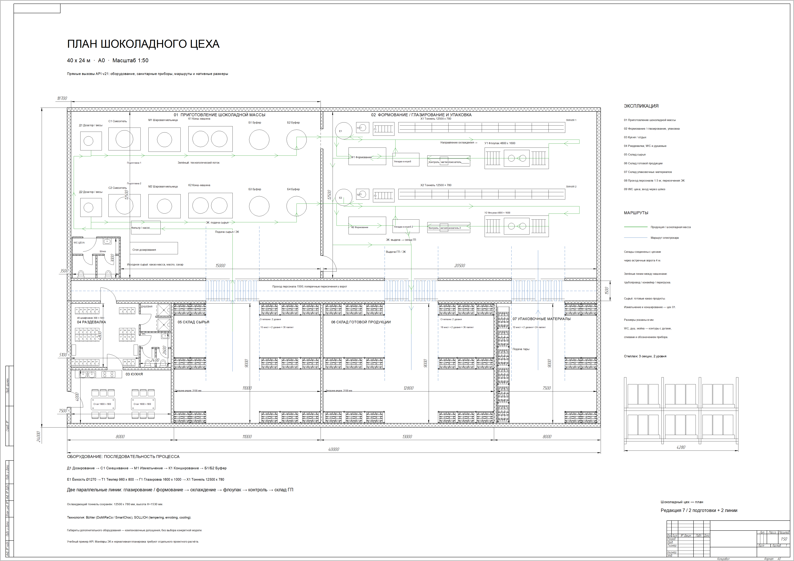
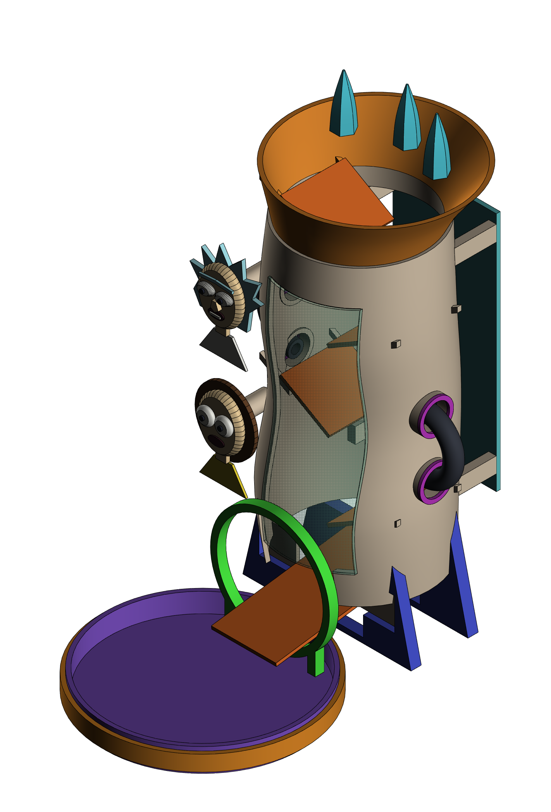
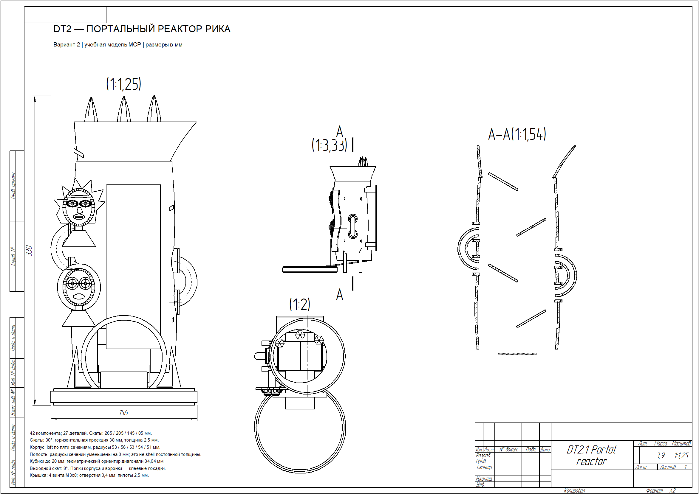

# Примеры результатов MCP

Это готовые примеры из КОМПАС-3D v21. Изображения получены штатным растровым экспортом CAD, а PDF — нативным экспортом чертежей.

## Шоколадный цех — редакция 7

План 40×24 м на листе A0, масштаб 1:50: две производственные линии, подготовка шоколадной массы, склады, бытовые помещения, размеры и маршруты.

[Полный лист PDF](factory/factory-plan-v7.pdf) · [Редактируемый CDW](factory/factory-plan-v7.cdw)

Это учебная компоновка для проверки API. PNG, PDF и CDW относятся к одной редакции 7. Более поздние рабочие файлы не подменяют этот опубликованный пример.

## Dice Tower V2.1

27 деталей, 42 компонента, 28 ассоциативных чертежей. Рельефы персонажей стилизованы; показана фактическая нативная модель, а не концептуальный AI-рендер.

[Сборочный чертёж PDF](dice-tower-v2.1/assembly.pdf) · [Модель и все чертежи — ZIP](dice-tower-v2.1/dice-tower-v2.1-native.zip)

Архив содержит A3D, все 27 M3D и 28 CDW/PDF. Распакуйте целиком: сборка и чертежи ссылаются на внешние модели. Если КОМПАС не находит источники из-за сохранённых абсолютных путей, переукажите их на распакованные файлы. Нативные исходники предназначены для КОМПАС-3D v21; для просмотра достаточно PNG/PDF.

В проверенной сборке 861 пара компонентов не имеет объёмных пересечений. Печатные допуски, прочность и движение кубика требуют физического прототипа. Клей и крепёж в модели не представлены.

## Воспроизведение

Сценарии и установка MCP описаны в [основном README](../../README.md). Башня создаётся через `examples/build_dice_tower_v2.py`, чертежи — через `examples/build_dice_tower_v2_drawings.py`. История учебного цеха описана в `docs/revision-*.md`, а сценарии сохранены в `examples/`.
